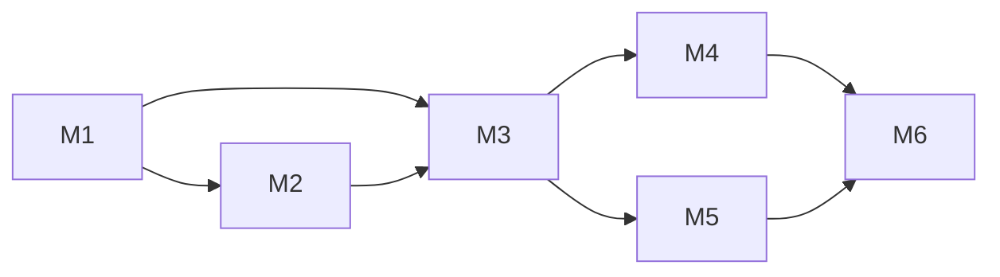

# InstantReplay v0.1 — Implementation Plan

> Status: **Draft** · 2026-10-29 · Scope from [SPEC.md](SPEC.md) §9 (v0.1 MVP)
> Team: one developer with AI assistance → small milestones, each verifiable on the reference device.

## Goal

A coach with two Android phones (or one phone + any browser) and no Internet can:
pair the devices, watch the live view, save the last 10–60 s with one tap, review the clip
in slow motion / frame by frame, tag it, and share it.

**Out of scope for v0.1:** trim, telestrator, remote camera settings, multi-camera, iOS, Play Store.

---

## How we work

- **Branches:** `main` stays releasable. One branch + PR per milestone task (`m2/outbox`, …), squash-merged.
- **Spike code:** `spike/phase-0` is the reference. Native code is moved into the plugin and hardened; the spike UI and server are rewritten.
- **Definition of done (every task):** analyzer clean, unit tests for pure logic, CI green, and checked on the Redmi (reference device) when it touches capture, network or UI.
- **Device loop:** PC hotspot + wireless adb (documented in `docs/dev-setup.md`).

---

## Milestones

Sizes: **S** ≈ one sitting · **M** ≈ a few sittings · **L** ≈ a week of evenings.

### M1 — Foundation (S–M)
| # | Task | Size | Done when |
|---|---|---|---|
| 1.1 | Pub workspace: `app/`, `packages/replay_protocol`, `packages/replay_capture_android` | S | `flutter pub get` at the root resolves all three |
| 1.2 | CI (GitHub Actions): analyze, Dart tests, Kotlin unit tests, `build apk`, `build web` | M | Green on a PR; APK + web bundle as artifacts |
| 1.3 | App shell: Riverpod, go_router, dark high-contrast theme, l10n (es/en ARB), role gate | M | App starts into role selection in both languages |
| 1.4 | `Capabilities` (native vs web) and conditional imports, so `dart:io`/plugins never reach the web build | S | `flutter build web` passes with the shell |
| 1.5 | CONTRIBUTING, issue/PR templates, `dev-setup.md` | S | — |

### M2 — Capture plugin, production grade (L)
| # | Task | Size | Done when |
|---|---|---|---|
| 2.1 | Pigeon API replaces the MethodChannel (start/stop, profiles, clips, live, events) | M | Typed API on both sides |
| 2.2 | **Secondary outputs on their own GL thread** (shared EGL context) | M | HQ gaps = camera gaps **and** live/preview at 30 fps |
| 2.3 | Profile detection: offer only profiles the camera supports in a regular session | S | Redmi shows 720p30/1080p30 only |
| 2.4 | Foreground service (`camera` type), keep-screen-on, operating mode (preview off, dimmed UI) | M | Survives screen-off and app switch for 30 min |
| 2.5 | Outbox: state machine (recording → ready → acked/expired), JSON index survives restarts, TTL 2 h, 1 GB cap | M | Unit tests + kill-app test |
| 2.6 | Epochs: profile change restarts encoder, clips never span epochs | S | Unit test with synthetic fragments |
| 2.7 | Thermal policy (SPEC §3.6) as events | S | Simulated status via debug hook |
| 2.8 | Live start bitrate (skip the 480p ramp-up) via `setBitrate` | S | First seconds already ≥ 960×540 |

**Decision (2026-10-29): keep fMP4 + `sidx` everywhere.** A 13 s clip copied to the gallery of the reference phone plays and seeks in the Xiaomi gallery and sends and plays in WhatsApp. No remux step on the Camera.

### M3 — Protocol and Camera server (M)
| # | Task | Size | Done when |
|---|---|---|---|
| 3.1 | `replay_protocol`: DTOs, WS message types, `protocolVersion`, JSON codecs | M | 100 % unit-tested round-trips |
| 3.2 | Server API v1 (SPEC §4.1): auth token, `/pair` with code + rate limit, clips with Range, ack | M | Integration tests with an in-process client |
| 3.3 | WS hub: hello/welcome, signaling, events, keep-alive, one-viewer-per-request delivery (D9) | M | Two clients see the right events |
| 3.4 | NSD announce (`bonsoir`), QR (`qr_flutter`) and 6-digit code on the Camera screen | S | Visible on the Camera setup screen |
| 3.5 | Camera UI: setup mode, operating mode, status (viewers, buffer, outbox, temperature) | M | Usable on a tripod |

### M4 — Native Viewer (L)
| # | Task | Size | Done when |
|---|---|---|---|
| 4.1 | Connect: NSD browse, QR scan (`mobile_scanner`), code entry, `bindProcessToNetwork` | M | Connects on PC hotspot and phone hotspot |
| 4.2 | Live view (`flutter_webrtc`) with reconnect | M | Survives Wi-Fi toggle (N8) |
| 4.3 | Save button + presets + post-roll; progress toast | S | N3 measured in debug overlay |
| 4.4 | Transfer: queue, Range resume, sha256, ack | M | Kill Wi-Fi mid-download → clip still arrives |
| 4.5 | Library (`drift`): sessions, clips, categories, tags, templates (5 built-in, JSON import/export) | M | Migrations tested |
| 4.6 | One-tap tag bar after save; library screen with filters | M | Tagging never blocks the next save |
| 4.7 | Player (`media_kit`): loop, 0.25/0.5/1×, frame ±1, scrub | M | Exact frame stepping on a 30 fps clip |
| 4.8 | Export: gallery (`gal`) and share (`share_plus`) | S | Clip lands in Photos and WhatsApp |
| 4.9 | Layouts: tablet landscape + phone portrait/landscape | M | Checked on phone and tablet |

### M5 — Web viewer (M)
| # | Task | Size | Done when |
|---|---|---|---|
| 5.1 | Web build with local CanvasKit and fonts; served by the Camera from APK assets | M | Loads with egress blocked |
| 5.2 | Web live view, save, session-only clips in IndexedDB, download | M | Works in Chrome desktop and Android |
| 5.3 | Frame stepping via `requestVideoFrameCallback`; screen wake workaround | S | — |
| 5.4 | Safari check (borrowed iPhone/iPad or cloud device) | S | Known limitations listed in README |

### M6 — Release v0.1 (S–M)
| # | Task | Size | Done when |
|---|---|---|---|
| 6.1 | Settings: presets, post-roll, language, theme, storage usage | S | — |
| 6.2 | Soak tests: 30 min and 90 min at 1080p30 with live view on (N5) | S | No HQ gaps beyond camera startup |
| 6.3 | Signed release APK in CI (keystore in GitHub secrets), GitHub Release with web bundle | S | Installable from the Release page |
| 6.4 | Setup guides (hotspot / travel router / tripod), README update in en + es | S | — |

---

## Order and dependencies

M2 and the protocol part of M3 (3.1) can run in parallel. M4 and M5 share the Viewer code, so M5 starts once 4.2–4.3 exist.

---

## Risks to watch

| Risk | Where | Mitigation |
|---|---|---|
| `flutter_webrtc` still uses the legacy Kotlin Gradle plugin; future Flutter may break it | M4 | Pin versions; track upstream; our plugin already depends on the same libwebrtc directly |
| Shared EGL context across threads (2.2) misbehaves on some GPUs | M2 | Fallback: keep the current "skip when behind" logic |
| fMP4 not accepted by gallery/WhatsApp | M2 decision point | Remux on the Camera |
| `media_kit` frame stepping or web support gaps | M4/M5 | Spike 4.7 early; HTML video fallback on web |
| No old device and no iOS device for testing | M2, M5 | Cheap used phone before M6; borrowed iPhone for 5.4 |
| Weak charger: battery drains even when plugged | Field use | Documented in setup guide; battery shown in Camera status |

---

## Open questions (needed before the milestone that uses them)

1. Default post-roll (proposal: 2 s) — M4.3
2. Default preset set (proposal: 20 s default, chips 10/30/60) — M4.3
3. Built-in tag templates content per sport — M4.5
4. App name and icon for the release, or keep "InstantReplay" — M6
