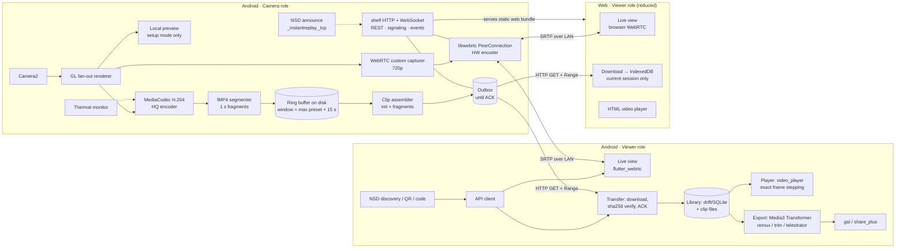
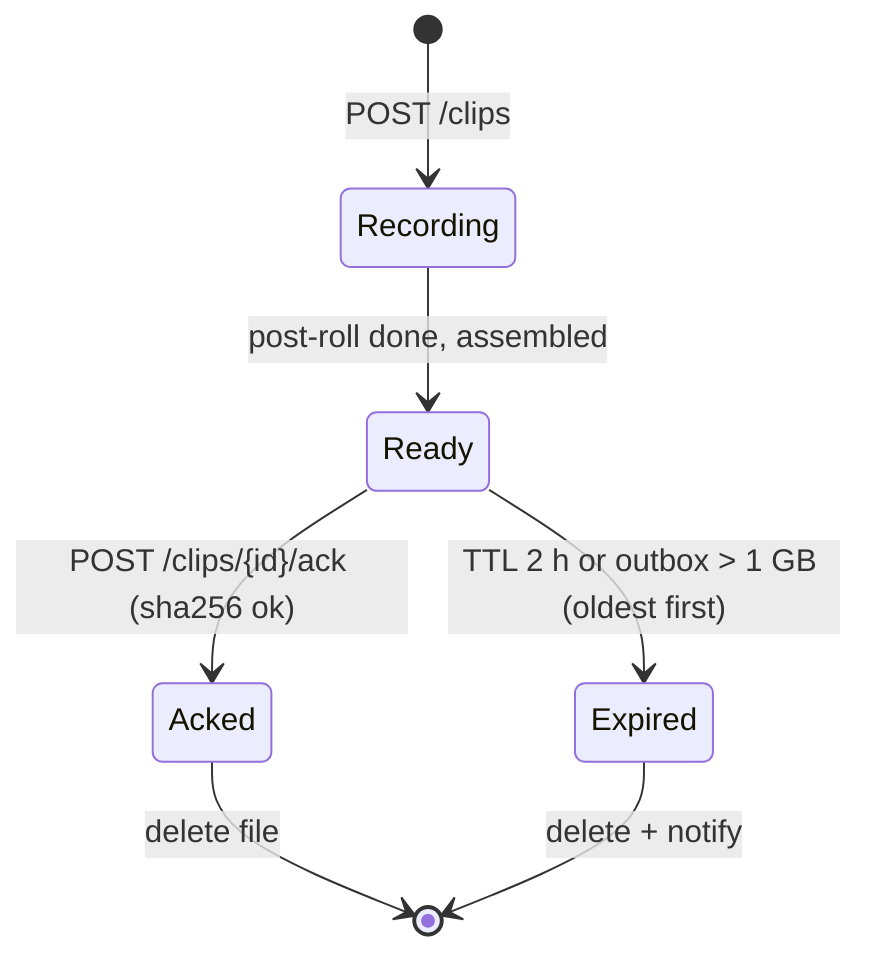

# InstantReplay — Architecture & Requirements Specification

> Status: **Draft v1** · 2026-10-29 · License: Apache-2.0
> Offline, local-network instant replay for team sports. One Flutter app, two roles.

---

## 1. Decisions log

| # | Topic | Decision |
|---|---|---|
| D1 | License | **Apache-2.0** (permissive + explicit patent grant, relevant for video codecs). |
| D2 | Platforms | One Flutter app with two roles. **Android** (API 29+, Android 10) for both roles. **Web** build = Viewer role only, reduced capabilities. iOS native: not planned now (web covers iPhone/iPad). |
| D3 | Users | Phase 1: technical users / early adopters (APK on GitHub Releases). Later: Play Store for amateur clubs. |
| D4 | Sport | Team sports first; generic and configurable via tag templates. |
| D5 | Cameras | 1 camera in MVP; protocol and data model carry `cameraId` to allow N later. |
| D6 | Viewers | Usually 1, occasionally 2–3 concurrent viewers. |
| D7 | Audio | **None.** Video only. |
| D8 | Storage | **Camera = clip buffer + outbox**, plus an optional **full-session recording** to its own gallery (§3.8). The clip library lives on the Viewer. Camera keeps a clip in an *outbox* until the requesting Viewer confirms the download (checksum). |
| D9 | Multi-viewer | A clip goes only to the viewer that requested it; other viewers get a notification and may fetch it while it is still in the outbox. |
| D10 | Organization | Session (match/training) → Clips. Sessions live on the Viewer. |
| D11 | Save button | Default duration (20 s) + presets (10/30/60 s) + configurable post-roll (0–5 s). |
| D12 | Video | Configurable: **1080p30 at 12 Mbps default**; 1080p30 at 8 Mbps (a third less storage), 720p30 or 1080p60 optional; the Camera remembers the last choice; a profile is offered only if the camera supports it in a regular session. H.264 only. |
| D13 | Analysis | Speed (0.25/0.5/1x), frame stepping, **non-destructive trim**, **telestrator burned into exported video as freeze-frame + drawing for N s**. |
| D14 | Export | Single clip: save to gallery + system share (native). Download (web). |
| D15 | Web | Live view + save + review of **current session only** (IndexedDB, volatile) + download MP4. No gallery/share/trim/telestrator. |
| D16 | Network | Viewer hotspot and travel router both supported; no assumption. |
| D17 | Camera control | Framing/setup on the Camera device, then dimmed "operating" mode; remote settings from the Viewer. |
| D18 | Tags | Per-sport templates, editable, JSON import/export. |
| D19 | Security | Per-session token, shared by QR or 6-digit code. Plain HTTP on the LAN. |
| D20 | UI | Dark high-contrast theme by default (light optional). Viewer: landscape on tablet, both orientations on phone. i18n **es + en** from day 1. |
| D21 | Code | Riverpod + feature-first layering. Code and docs in English; README also in Spanish. |
| D22 | Hosting | GitHub monorepo, GitHub Actions, APK + web bundle in Releases. |
| D23 | Team | Solo developer with AI assistance → small, verifiable phases; minimize custom native code. |
| D24 | MVP scope | Core replay + live view WebRTC + web build. Trim/telestrator in v0.2. |

---

## 2. System overview



### 2.1 Key principle: one camera owner, GL fan-out
The camera is opened once by a native Kotlin module. Frames go to a `SurfaceTexture`, and an OpenGL ES renderer draws each frame to several output surfaces:
1. **HQ encoder** input surface (MediaCodec, buffer quality).
2. **WebRTC capturer** (libwebrtc `VideoCapturer` fed from our texture, scaled to 720p; libwebrtc owns the live encoder and congestion control).
3. **Local preview** (only during setup; disabled in operating mode to save power).

This avoids relying on Camera2 multi-stream combinations, which differ between devices, and leaves room for overlays later (e.g. a timestamp).

---

## 3. Camera role (Device A)

### 3.1 Capture & encode
- Camera2 (or CameraX `Preview` → our `SurfaceTexture`), with fixed AE/AF behavior configurable remotely.
- HQ encoder: H.264 High (fallback Main), CBR/VBR configurable, **GOP = 1 s**, repeat SPS/PPS on every IDR.

| Profile | Resolution | FPS | Target bitrate |
|---|---|---|---|
| Low | 1280×720 | 30 | 5 Mbps |
| **Default** | 1920×1080 | 30 | 12 Mbps |
| High | 1920×1080 | 60 | 20 Mbps |

- Changing a profile restarts the encoder and starts a new **buffer epoch** (new init segment). A clip never spans epochs; if a request crosses an epoch boundary it is truncated to the current epoch.

### 3.2 Ring buffer
- Encoder output → **fMP4 fragments of 1 s**, each starting with an IDR. One file per fragment + one init segment (`ftyp+moov`) per epoch.
- Implementation: Media3 `FragmentedMp4Muxer` if it allows per-fragment output; otherwise a minimal custom H.264-only fMP4 writer (decided in Phase 0).
- Window = longest preset + post-roll + 15 s margin (default: 80 s). Oldest fragments deleted FIFO.
- In-memory index: `[(seq, ptsStart, ptsEnd, path, bytes)]`.
- Footprint: ~120 MB at default profile, ~200 MB at 1080p60. Startup check: refuse to start if free space < 1 GB.

### 3.3 Clip assembly
1. `POST /api/v1/clips {preSeconds, postSeconds, requestId}` → `t0 = now` on A's clock.
2. Wait for post-roll (fragments up to `t0 + post` closed).
3. Select fragments covering `[t0 - pre, t0 + post]` (extended to the previous keyframe → actual length is up to +1 s).
4. Write `init + fragments` by byte concatenation into a single fMP4 in the outbox. Target: **< 300 ms** after the last fragment closes.
5. Compute sha256, emit `clip_ready` over WebSocket to the requester (and `clip_available` to other viewers).

`decodeTime` stays continuous within an epoch, so the concatenated file is a valid fragmented MP4 without rewriting.

### 3.4 Outbox lifecycle

- Other viewers may download while `Ready`. The file is deleted once the requester ACKs; other viewers lose access then.
- Outbox survives app restarts (index persisted as JSON).

### 3.5 Operating modes (UI on A)
- **Setup:** full preview, framing grid, zoom/exposure/focus, quality profile, QR + 6-digit code, network info.
- **Operating:** screen dimmed to minimum, black UI with status only (recording, viewers, temperature, buffer, outbox). Tap to wake into setup.
- Foreground service (`foregroundServiceType="camera"`), screen kept on, warning if not charging.

### 3.6 Thermal policy
Uses `PowerManager.getCurrentThermalStatus` (API 29) and `getThermalHeadroom` (API 30+ when available).

| Status | Action |
|---|---|
| MODERATE | Disable local preview, notify viewers |
| SEVERE | 60→30 fps; reduce live bitrate to 1.5 Mbps |
| CRITICAL | 1080p→720p HQ; warn "camera overheating" |
| EMERGENCY | Stop live; keep buffer if possible |

Every degradation is reported as a `thermal_state` event and in the UI. No automatic upgrade back during a session (avoids oscillation); the user can restore manually.

### 3.8 Full-session recording
Besides the clip buffer, the Camera can record the **whole session** (the match, the training) into its own gallery, `Movies/InstantReplay`, to review it later on a bigger screen. Video only (D7).

**Who controls it.** There is one recording, and it lives on the Camera. **Any paired Viewer** (native or web) and **the Camera itself** can Record, Pause and Finish it; they all see the same state. If a Viewer disconnects, the recording carries on. Leaving the Camera screen finishes it and saves what was recorded.

**States.** `idle → recording ⇄ paused → idle`. A session starts **idle**: nothing is recorded until someone presses Record. Pausing cuts at the end of the fragment (second) in progress. Finish asks for confirmation on both roles. Record and Resume can also **include the last 30 s** of the ring buffer (`includeSeconds`), for when the coach presses a moment late.

**File format.**
- Written progressively as **fMP4** (the same 1 s fragments as the buffer) into a MediaStore item marked *pending*, so it is invisible in the gallery until finished and nothing is lost if the app dies.
- Pause works per fragment: fragments are simply not written while paused, and `decodeTime` stays **continuous** across pauses, so the file plays without a gap or a jump.
- At finish, an index and a `sidx` are written (seekable in galleries and players, see Phase 0 results) and the item is published.
- **Parts:** an encoder restart (profile change, thermal fallback) needs a new init segment, so the recording continues in a **new part** (a new file in the gallery); so does every **4 h** of video, to keep files manageable. The Viewer's profile change stays allowed during a recording. The UI shows "part N" when there is more than one.
- **Names:** `InstantReplay_yyyy-MM-dd_HH-mm.mp4` (the recording's start time), then `…_part2.mp4`, `…_part3.mp4`.

**Space.**

| Free space / time left | Action |
|---|---|
| < 1 GB free | Refuse to start (`no_space`) |
| < 10 min left at the current bitrate | `lowSpace` warning on the Camera and every Viewer |
| < 500 MB free | Stop and save (`recording_finished` with reason `lowSpace`), told to everyone |

The 500 MB floor keeps room for the ring buffer and the outbox, so clip saving keeps working after the recording stops.

**Crash recovery.** On entry to the Camera role, before capture starts, recordings left *pending* by a crash or a kill are finished (index + `sidx` written from the fragments on disk) and published automatically. The Camera shows a note such as "Recovered a 47 min recording".

**Reporting.** The state rides on every `status` as `sessionRecording` (§4.2), and changes are pushed at once rather than with the next 1 s tick. A finished recording is announced to every Viewer with `recording_finished` (reason `user`, `lowSpace`, `error` or `recovered`).

---

## 4. Network, discovery, pairing

- **Server:** `shelf` on a fixed default port (8080, configurable) bound to all interfaces of the Wi-Fi/hotspot network.
- **Discovery (native Viewer):** NSD/DNS-SD service `_instantreplay._tcp` with TXT `{v, cameraId, name}` (package `bonsoir`).
- **Pairing:**
  - QR on A: `http://<ip>:<port>/?k=<token>`, which opens the web viewer directly or is scanned by the native viewer.
  - 6-digit code: shown on A, entered on the Viewer after NSD discovery; exchanged for the token via `POST /api/v1/pair`. Rate-limited (5 attempts/min).
  - Token: 128-bit random, valid for the Camera's run; regenerating it disconnects all viewers.
  - Web stores the token in a cookie (`HttpOnly`, `SameSite=Strict`) and strips it from the URL.
- **Android routing:** the Viewer calls `ConnectivityManager.bindProcessToNetwork` on the Wi-Fi network, so traffic does not go to mobile data when the Wi-Fi has no Internet.
- **No Internet anywhere:** no STUN/TURN, no CDNs, no fonts or assets fetched remotely. CI test: web bundle loads with network egress blocked.

### 4.1 API (v1)
All routes require `Authorization: Bearer <token>` (or cookie for web), except static files and `/pair`.

| Method | Route | Purpose |
|---|---|---|
| GET | `/` | Web viewer bundle (static) |
| POST | `/api/v1/pair` | `{code}` → `{token}` |
| GET | `/api/v1/info` | Protocol version, camera id/name, profile, capabilities |
| POST | `/api/v1/clips` | `{requestId, preSeconds, postSeconds}` → `202 {clipId, eta}` |
| GET | `/api/v1/clips/{id}` | fMP4 file, `Range` supported |
| GET | `/api/v1/clips/{id}?format=mp4` | Progressive MP4 (passthrough remux on A, for web download) |
| POST | `/api/v1/clips/{id}/ack` | `{sha256}` → outbox releases |
| GET | `/api/v1/clips` | Outbox listing (for recovery after reconnect) |
| GET | `/api/v1/thumbnail` | Latest JPEG frame (fallback when live view is off) |
| WS | `/api/v1/ws` | Signaling + events + remote control |

`requestId` makes `POST /clips` idempotent, so a retry after a timeout does not create a duplicate clip.

### 4.2 WebSocket messages
JSON `{type, id?, payload}`. Shared Dart package `replay_protocol` defines all messages.
- Handshake: `hello {protocolVersion, role, viewerId, viewerName}` → `welcome {cameraId, capabilities, settings}`.
- Signaling: `rtc_offer`, `rtc_answer`, `rtc_ice` (A is the offerer; host candidates only; browser mDNS candidates resolved via peer-reflexive).
- Events: `clip_recording`, `clip_ready`, `clip_available`, `clip_expired`, `thermal_state`, `buffer_state`, `settings_changed`.
- Control: `camera_set {zoom?, exposureComp?, focusMode?, profile?}` → `settings_changed`.
- Full-session recording (§3.8):
  - Viewer → Camera: `rec_start {includeSeconds?}` (start, or resume when paused; `includeSeconds` > 0 also keeps that much of the buffer, omitted = 0), `rec_pause`, `rec_stop`. The new state arrives in the next `status`, sent at once; a refusal comes back as `error {code: "no_space"}` (less than 1 GB free) or `error {code: "rec_failed", message}`.
  - Camera → all viewers: `recording_finished {name, parts, durationMs, reason}`, with `reason` one of `user`, `lowSpace`, `error`, `recovered`; `name` is the first part's file name.
  - In `status`: `sessionRecording {state: idle|recording|paused, elapsedMs, parts, freeBytes, lowSpace, remainingMs?}`. `elapsedMs` excludes pauses; `remainingMs` is the estimated time left at the current bitrate; `lowSpace` means under 10 min left. Absent from a Camera without the feature, and viewers then hide the controls.
- Keep-alive: ping every 5 s; viewer marked gone after 15 s.

---

## 5. Viewer role (Device B, native Android)

### 5.1 Screens
1. **Role select** (first run; remembered).
2. **Connect:** discovered cameras list, Scan QR, Enter code, network hint (hotspot/router guide).
3. **Session picker:** new session (name, type match/training, template) or continue the latest one.
4. **Live control (main screen)**
   - Live video full-bleed; status bar (latency, camera temperature, buffer).
   - Huge **SAVE** button (default duration) + small preset chips 10/30/60 s.
   - After save: progress toast → clip card with **one-tap tag bar** (category + tags from the session template). Tagging never blocks the next save.
   - Tablet landscape: video + right-side tag rail. Phone portrait: video top, controls bottom (one-hand).
5. **Clip review (modal):** autoplay loop, speed 0.25/0.5/1x, frame ±1, scrub; title, category, tags, notes. *(v0.2: trim handles, telestrator.)* Export → gallery / share.
6. **Library:** sessions → clips, filter by category/tag, batch delete.
7. **Settings:** default duration/presets/post-roll, tag templates (edit/import/export JSON), language, theme, storage usage, camera remote settings.

### 5.2 Transfer
- On `clip_ready`: GET with Range resume → write to temp → verify sha256 → move into library → `ack`.
- On reconnect: `GET /clips` to fetch any pending clip requested by this viewer.
- Queue processes one download at a time; live view keeps priority (the bitrate impact of a 30 MB download on 5 GHz is acceptable; measure in Phase 0).

### 5.3 Data model (drift / SQLite)
```
Session(id, name, type[match|training|other], startedAt, templateId)
Clip(id, sessionId, cameraId, requestedAt, cameraTime, durationMs, filePath,
     sizeBytes, sha256, title, categoryId?, notes,
     trimStartMs?, trimEndMs?,            -- v0.2, non-destructive
     createdAt, updatedAt)
Category(id, templateId, name, color, order)
Tag(id, templateId, name, order)
ClipTag(clipId, tagId)
Annotation(id, clipId, frameTimeMs, holdMs, strokesJson, createdAt)   -- v0.2
TagTemplate(id, name, sport, builtIn, schemaVersion)
```
Clip files: `<app files>/clips/<sessionId>/<clipId>.mp4` (fMP4). Storage usage in Settings; no automatic deletion.

Built-in templates: Football, Basketball, Handball, Hockey, Generic (categories: Attack / Defense / Transition / Set piece; tags per sport).

### 5.4 Export pipeline (native, Media3 Transformer)
- **Plain export:** passthrough remux fMP4 → progressive MP4 (`moov` first), applying trim (keyframe-aligned, with Transformer trim optimization for exact cuts).
- **Telestrator export (v0.2):** Composition = `[clip start → t₁] + [PNG of frame t₁ with drawings, holdMs] + [t₁ → next annotation] + … + [→ end]`. Requires re-encode; progress UI, cancellable, runs only on the Viewer.
- Output to cache → `gal` (gallery) or `share_plus`.

### 5.5 Player
`video_player` (ExoPlayer on Android, `<video>` on web): exact frame stepping (forward and backward), `rate` 0.25/0.5/1, seamless loop. Gestures: tap play/pause, horizontal drag scrub (one frame per 6 px), scrub bar, ±1 frame buttons. *(Pinch zoom: not in scope.)*

**Exact stepping.** The Viewer reads every frame's timestamp from the clip itself (`moov` timescale + each `moof`'s `tfdt`/`trun`, skipping `mdat`), so camera jitter and dropped frames are respected. A step pauses, snaps to the frame on screen, moves ±1 in that list and seeks to a whole-millisecond position the player is known to resolve to exactly that frame: ExoPlayer seeks exactly and shows the first frame at or after the position (seek to the frame start, floored to ms); `<video>` shows the frame whose interval contains `currentTime` (seek to the middle of the frame). If the file can't be parsed, a 30 fps grid is used.

**Decision (v0.1): stay on `video_player`, not `media_kit`.** Measured on this project (release, `--split-per-abi`): `media_kit` + `media_kit_video` + `media_kit_libs_video` build fine next to `flutter_webrtc`, but add **+12.3 MB to the arm64 APK** (54.9 → 67.2 MB, +22 %), +12.2 MB to armeabi-v7a and +16.3 MB to x86_64, so the universal APK grows by ~40 MB. Its exact stepping (mpv `frame-step` / `frame-back-step`) exists only on native: on web it is a plain `<video>`, so web would still need the approach above. Releases have also slowed (latest `media_kit` ~10 months old; `media_kit_libs_android_video` unlisted on pub.dev). Since timestamp-driven seeks give exact stepping on both platforms with the player we already ship, libmpv's size is not worth it. Revisit if we need things ExoPlayer can't do (e.g. reverse playback).

---

## 6. Web viewer (reduced)

Built from the same Flutter codebase (`flutter build web`), bundled inside the APK and served by A.

| Capability | Web | Notes |
|---|---|---|
| Live view | ✅ | Browser WebRTC (works on plain HTTP) |
| Save + presets | ✅ | |
| Tagging | ✅ | Current session only |
| Clip review loop + speed | ✅ | `<video>` + `playbackRate` |
| Frame stepping | ✅ | Exact: frame timestamps from the clip (§5.5); `requestVideoFrameCallback` tells which frame is on screen |
| Storage | 🟡 | IndexedDB, current session only; may be evicted (Safari). Banner says so |
| Download | ✅ | `?format=mp4` progressive → `<a download>` |
| Gallery / share / trim / telestrator / library / remote camera settings | ❌ | Hidden via `Capabilities` |
| Screen wake | 🟡 | While a review is paused: Wake Lock on HTTPS, otherwise a hidden looping muted copy of the clip |

Build requirements:
- CanvasKit and all fonts bundled locally (no Google CDN); JS renderer, not wasm (cross-origin isolation is unavailable without HTTPS).
- CI job: serve the bundle with egress blocked, smoke-test with Playwright (Chromium).
- Size budget: ≤ 6 MB gzipped.

The web viewer ACKs a clip after storing it in IndexedDB; the Camera then deletes it.

---

## 7. Project structure

```
instantreplay/
├─ app/                              # Flutter app (Android + web)
│  ├─ lib/
│  │  ├─ main.dart
│  │  ├─ app/                        # router, theme, l10n, role gate
│  │  ├─ core/                       # capabilities, logging, result, utils
│  │  └─ features/
│  │     ├─ role/                    # role selection
│  │     ├─ camera/                  # A: setup/operating UI, plugin facade, thermal
│  │     ├─ server/                  # A: shelf API, WS hub, auth, outbox, static web
│  │     ├─ discovery/               # NSD announce/browse, QR, code pairing
│  │     ├─ live/                    # B: WebRTC viewer + signaling client
│  │     ├─ transfer/                # B: download, verify, ack, resume
│  │     ├─ library/                 # B: drift DB, sessions, clips, templates
│  │     ├─ tagging/                 # B: tag bar, templates editor
│  │     ├─ player/                  # B: review modal (native + web impls)
│  │     ├─ export/                  # B native: Transformer, gal, share
│  │     └─ settings/
│  │     (each feature: data/ domain/ presentation/)
│  ├─ l10n/                          # app_en.arb, app_es.arb
│  ├─ assets/web_viewer/             # web build copied here by CI
│  └─ test/ integration_test/
├─ packages/
│  ├─ replay_protocol/               # pure Dart: DTOs, WS messages, versioning
│  └─ replay_capture_android/        # Flutter plugin (Kotlin):
│     └─ android/src/main/kotlin/…   #   Camera2, GL fan-out, MediaCodec, fMP4,
│                                    #   ring buffer, clip assembler, remux,
│                                    #   WebRTC sender (custom capturer), thermal
├─ docs/ (SPEC.md, ADRs, setup guides: hotspot, router, tripod)
├─ .github/ (workflows, issue/PR templates)
├─ LICENSE (Apache-2.0) · README.md · README.es.md · CONTRIBUTING.md · CODE_OF_CONDUCT.md
```

Native ↔ Dart boundary: Pigeon-generated API for commands (`start`, `stop`, `setProfile`, `assembleClip`, `remux`), EventChannel for status/thermal/buffer events. Signaling messages flow Dart ↔ native through the same channel.

### 7.1 Dependencies (all permissive; CI license check)
Flutter / Dart: `flutter_riverpod`, `go_router`, `shelf`, `shelf_router`, `shelf_web_socket`, `shelf_static`, `web_socket_channel`, `flutter_webrtc`, `video_player`, `drift`, `bonsoir`, `mobile_scanner`, `qr_flutter`, `gal`, `share_plus`, `crypto`, `intl`.
Android: Camera2/CameraX, MediaCodec, `androidx.media3` (muxer, transformer), libwebrtc (**the same artifact flutter_webrtc ships**, to avoid duplicate classes — verify in Phase 0).

H.264 note: encoding and decoding use the device's licensed hardware codecs; the project ships no codec implementation.

---

## 8. Non-functional requirements & acceptance criteria

| ID | Requirement | Target | How measured |
|---|---|---|---|
| N1 | Live latency glass-to-glass (native) | < 400 ms p95 | Film a ms stopwatch shown next to the Viewer screen |
| N2 | Live latency (web, Chrome) | < 400 ms p95 | Same |
| N3 | Save → clip playing on Viewer (20 s clip, default profile) | < post-roll + 3 s | Timestamps in debug overlay |
| N4 | Clip assembly on A | < 300 ms | Native log |
| N5 | Continuous session on reference device | 90 min, no HQ frame gaps, thermal ≤ SEVERE, charging, operating mode | Soak test script + frame-gap counter |
| N6 | Buffer disk footprint | ≤ 250 MB at worst profile | Status endpoint |
| N7 | Camera app RAM | < 400 MB PSS | `dumpsys meminfo` |
| N8 | Reconnect after Wi-Fi drop | Auto, < 5 s after network returns; no clip lost | Manual test toggling Wi-Fi |
| N9 | Fully offline | No outbound request ever | CI with egress blocked + manual airplane-mode test |
| N10 | Accessibility | Touch targets ≥ 56 dp for primary actions, contrast ≥ 7:1 on main screen | Review checklist |

Why 400 ms for N1/N2: the live view is used to decide *when* to press Save, not for analysis. The cut is made on the Camera's clock when the request arrives, so live latency only shifts the clip by that amount, which the pre-roll and the post-roll absorb.

---

## 9. Roadmap

### Phase 0 — Native spike (go/no-go)
- Camera2 → GL fan-out → MediaCodec HQ → 1 s fMP4 fragments → concatenated clip plays in VLC/mpv and Android gallery after remux.
- Custom WebRTC capturer streaming to a browser page on the LAN; confirm no class conflict with `flutter_webrtc`.
- 30-min thermal run on the reference phone at 1080p30 and 1080p60.
- **Exit criteria:** N1, N4 met; 30 min without HQ gaps.

**Results so far** (Redmi Note 12 Pro 5G, Dimensity 1080, Android 14 / HyperOS 2, 2026-10-29):

| Check | Result |
|---|---|
| HQ capture 1080p30 | 30 fps steady, H.264 High via `c2.mtk.avc.encoder` |
| Ring buffer | 80 s window ≈ 119 MB, FIFO rotation OK |
| Clip assembly (N4) | 98 ms for a 13 s clip; plays and seeks in ffmpeg and Chrome |
| Live view (N2) | 720p30 H.264 (hardware encoder) to Chrome over a Windows hotspot; 333–350 ms glass-to-glass, 0 packets lost |
| Library coexistence | Plugin and `flutter_webrtc` share `io.github.webrtc-sdk:android`; no duplicate classes. Requires `ACCESS_NETWORK_STATE`, otherwise libwebrtc aborts natively |
| Thermal, 10 min | Status `none`, battery 40.5 → 41.8 °C, fps unaffected |
| Frame gaps (M2) | The camera feeds the HQ encoder directly (two Camera2 outputs: 1080p encoder + 720p texture), so GL can't drop recorded frames. Preview/live render on their own GL thread at 30 fps. Screen on: 0 gaps. Screen off: the GL path lost ~6 frames/s; the direct path loses none, but the camera itself skips frames for ~1 min after screen-off (181 in one test), then holds 30 fps. Recommended setup: operating mode (screen on, black) |
| 1080p60 | Not available: regular sessions top out at 30 fps (`aeAvailableTargetFpsRanges` max [30,30]); 60 fps only exists inside constrained high-speed sessions at 120 fps. Decision: offer each profile only when the device's regular session supports it |
| Image orientation | Camera2 tags SurfaceTexture outputs with a portrait-preview rotation; stripped in GL. The encoder stream keeps the sensor's landscape frame (180° sensors via the MP4 track matrix) |
| Clip format | fMP4 + `sidx` plays and seeks in the Xiaomi gallery and in WhatsApp: no remux |
| Pending | 30-min soak on the final build; first live connection can fail (offer without ICE candidates → trickle ICE in M3) |

### v0.1 — MVP
Roles, pairing (QR, code, NSD), ring buffer + outbox + API v1, transfer with ACK/resume, sessions/clips/templates, player (speed, frame step), live view (native + web), web viewer (session-only), export plain clip to gallery/share, thermal policy, operating mode, es/en, dark theme, CI building APK + web, GitHub Release.

### v0.2 — Analysis
Non-destructive trim, telestrator with freeze-frame burn-in on export, annotations stored per clip.

### v0.3 — Polish & distribution
Remote camera settings from Viewer, multi-viewer refinements, template sharing (JSON), Play Store listing, onboarding/setup guides.

### Later
Multiple cameras (clock offset via WS ping, `cameraId` already in model), iOS viewer, session export (ZIP + JSON), optional audio.

---

## 10. Risks

| Risk | Impact | Mitigation |
|---|---|---|
| libwebrtc custom capturer conflicts with flutter_webrtc in the same APK | Blocks live view on the Camera side | Phase 0; reuse flutter_webrtc's bundled lib; fallback: H.264-over-WS + MSE for live |
| Thermal throttling on mid-range phones | Dropped frames, shutdown | GL fan-out (one capture), operating mode, staged degradation, recommend charging + shade |
| **No old device (2019–2021) for testing** | API 29 / weak encoders untested | Acquire a cheap used phone before v0.1, or use Firebase Test Lab for encoder smoke tests |
| **No iPhone/iPad for testing** | Safari web viewer untested | Borrow a device or use a cloud device service before v0.1 release |
| fMP4 not accepted by some galleries/apps | Export fails | Always remux to progressive MP4 on export |
| Viewer hotspot + Android routing to mobile data | Connection failures | `bindProcessToNetwork`, setup guide, connection diagnostics screen |
| Safari evicts IndexedDB | Web clips lost | Session-only by design, clear banner, quick download |
| Generic name "InstantReplay" | Hard to find, possible store conflicts | Check Play Store/trademarks before v0.3 listing |

---

## 11. Open questions
- Default post-roll value (proposal: 2 s).
- Default telestrator hold duration (proposal: 3 s) and drawing tools set (arrow, line, circle, freehand, color, undo).
- Whether the Viewer should also keep a low-quality local buffer of the live stream for instant preview while the HQ clip downloads (deferred; measure N3 first).
